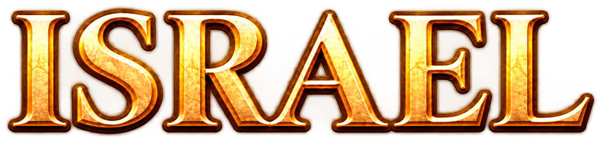
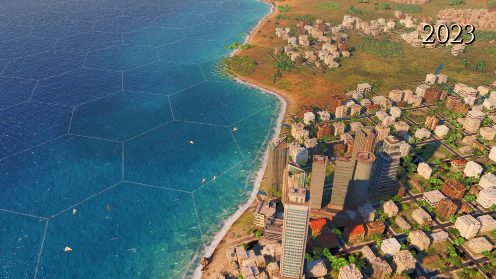
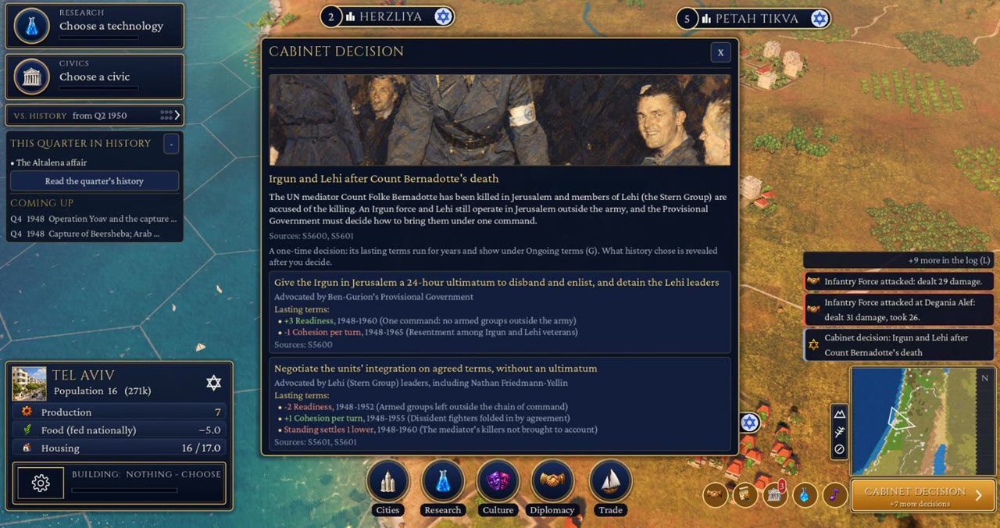
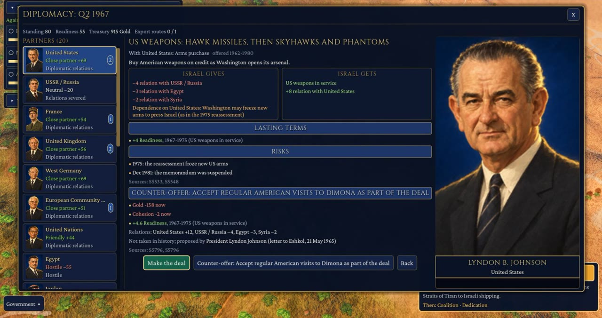
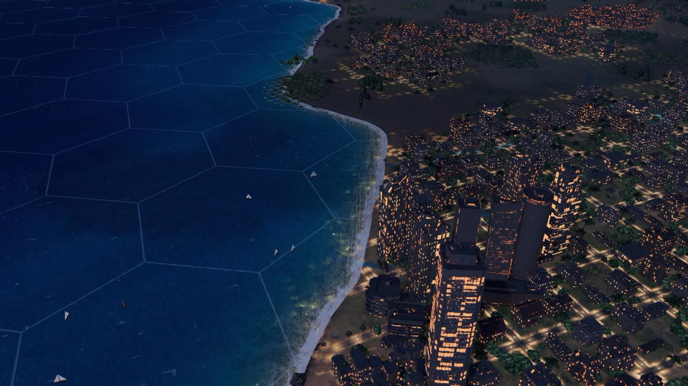
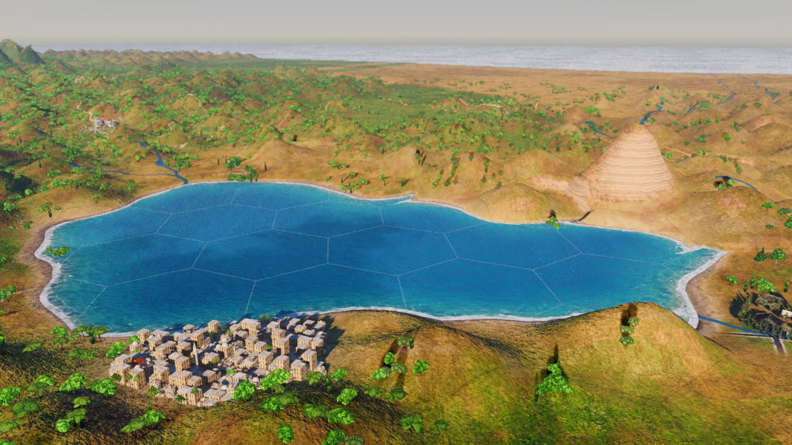

<p align="center">
  
</p>

<p align="center">
  <b>A Civilization&nbsp;VI–style historical strategy game.</b><br>
  Lead the State of Israel from the Declaration of Independence on 14&nbsp;May&nbsp;1948 to the autumn of 2023, one quarter per turn.<br>
  Built in <a href="https://godotengine.org">Godot&nbsp;4.7.1</a>. English and Hebrew (full right-to-left UI). Windows, macOS and the browser.
</p>

<p align="center">
  
</p>

---

## What it is

You are the government, from the Provisional State Council in 1948 to the cabinet of 2023. Every quarter you balance the treasury, immigration, housing, security, diplomacy and public trust, while 75 years of real history arrive on schedule.

- **302 turns of sourced history.** 319 events, 223 cabinet dilemmas and 23 wars and operations, from the War of Independence to Guardian of the Walls. Every date, number and quote cites one of **1,204 sources**, each opened and quoted.
- **Real choices, real advocates.** Each option in a dilemma names who argued for it at the time. Its lasting effects run for years, and after you decide, the game shows what history actually chose.
- **A living map.** 119 cities and towns grow on a 3D hex map built from real elevation data, from the 1948 coastline villages to the 2023 skyline. It has a real-time day/night cycle and three graphics levels (SD, HD and HD+).
- **Two ways to play.** *Full control* (the default) gives you every lever. *Story mode* hands the routine to your ministers, so you only make the big calls.
- **Diplomacy with 20 partners**, from the US and the USSR to Egypt, Jordan and the UN. You trade arms deals, aid and recognition, and partners make counter-offers.
- **Soft fail states.** Fiscal default, loss of public trust and military collapse each come with warnings and a way back.
- **Scenarios.** Start in 1948, 1967, 1977 or 1992, at four difficulty levels.
- **The ending.** The game ends at Q3 2023 with a short memorial for 7 October 2023, and nothing after it.

<table>
  <tr>
    <td width="50%"></td>
    <td width="50%"></td>
  </tr>
  <tr>
    <td><sub>Cabinet decisions: sourced, with named advocates and lasting terms.</sub></td>
    <td><sub>Diplomacy: deals, risks and counter-offers drawn from the record.</sub></td>
  </tr>
  <tr>
    <td></td>
    <td></td>
  </tr>
  <tr>
    <td><sub>Real-time day and night.</sub></td>
    <td><sub>HD+ terrain: the Sea of Galilee and the Golan.</sub></td>
  </tr>
</table>

## Play it from source (2 minutes)

1. Install **Godot 4.7.1** (standard build, not .NET). On Windows: `winget install GodotEngine.GodotEngine`.
2. Clone the repo. It's about 2 GB, because the art, models and audio are in the repo.
   ```
   git clone https://github.com/djtoon/israel.git
   ```
3. Open `game/project.godot` in Godot and press **F5**. The first import takes a few minutes. On Windows you can also double-click `PLAY_CURRENT.bat`.

## Make it yours

The game is data-driven: most of the history lives in JSON, so you can change a lot without touching code.

| You want to… | Edit |
|---|---|
| Add or change a historical event | `game/data/events.json` |
| Write a new cabinet dilemma | `game/data/forks/<era>.json` |
| Change a war | `game/data/wars/war_<year>_<name>.json` |
| Tune the economy, techs or units | `game/data/{fiscal,techs,civics,buildings,units}.json` |
| Add a city or change its population | `game/data/cities.json` |
| Translate or fix Hebrew text | `game/i18n/he/*.json` (UI) and `game/data/i18n/he/*.json` (data) |
| Change the 3D map or graphics | `game/scripts/map/` (see `MAP_API.md`) |
| Change the rules | `game/scripts/sim/` (see `API.md`) |

**Working with an AI coding agent?** Point it at [`AGENTS.md`](AGENTS.md). It has the map of the code, the data schemas, the test commands and the house rules. Claude Code picks it up automatically through `CLAUDE.md`.

## Tests

Everything runs headless. Use bash (Git Bash on Windows). `tools/godot.sh` finds Godot (set `GODOT_EXE` to point it elsewhere) and never runs more than two instances at once. `--ui-test` takes an absolute output folder.

```bash
# simulation suites
tools/godot.sh --headless --path game --script res://scripts/sim/sim_test.gd
# play 40 turns through the real UI
tools/godot.sh --headless --path game -- --lang=en --ui-test=C:/tmp/ui/en40 --ui-test-turns=40
# check every window at every screen size
tools/godot.sh --headless --path game -- --ui-test=C:/tmp/ui/layout --ui-test-layout
# check the history citations
python tools/check_sources.py
```

## Repository map

```
game/            the Godot project (scenes, scripts, data, assets, i18n)
sources/         the citation database: sources.json -> SOURCES.md
tools/           launchers, asset generation (gen.py), history and i18n tooling
build/full/      Windows and macOS release pipeline
build/web/       browser (HTML5) build for itch.io
docs/            images for this README
CONTRACT.md      the shared rules for history, art and code
V1.md … V5.md    the scope of each version, as it was built
```

## How it was made

*Israel* was designed and built with AI coding agents (Claude Code), working in builder and critic loops against three bars: a target screenshot for the look, Civilization VI for the play, and published sources for the history. The 2D art, 3D models, music and sound were generated with the pipeline in `tools/gen.py` (Replicate models), then hand-picked and post-processed. The fonts are open-source Google Fonts under the SIL Open Font License.

## History and neutrality

The history aims to be factual, neutral and sourced. Events show every affected population, Israeli, Palestinian Arab and neighbouring states alike. Where sources disagree, the game says so and cites both. The citation database is in `sources/`. If you find an error, please open an issue with a source.

## License

[MIT](LICENSE): code, data and the generated art, models and audio. The bundled fonts (Cinzel, Cormorant Garamond, Crimson Pro, Frank Ruhl Libre and Noto Sans Hebrew) keep their own SIL Open Font License; see `game/assets/fonts/OFL_*.txt`.
